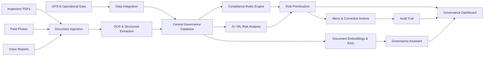

# ⛏️ MineGuard AI
### AI-Powered Smart Governance & Compliance Monitoring for Coal Mines

**From Reactive Compliance to Proactive, AI-Driven Mine Governance.**

MineGuard AI is an intelligent governance platform that unifies coal mine inspections, regulatory compliance records, field observations, and operational data into one centralized system. It detects potential compliance gaps, identifies emerging risks, prioritizes corrective actions, and helps mine officials make faster, evidence-based decisions through real-time dashboards and geo-tagged reporting.

> **Our vision:** Every compliance gap should be visible, every critical risk should be prioritized, and every corrective action should have a clear path to closure.

---

## 🚨 The Problem

Coal mine governance involves multiple data sources, periodic inspections, safety observations, environmental records, and regulatory obligations. When this information is fragmented across documents and manual workflows, important warning signs can be missed.

- **Fragmented compliance data:** Inspection reports, operational records, and compliance documents are difficult to analyze together.
- **Delayed risk identification:** Recurring violations and emerging hazards may not be identified early enough.
- **Manual corrective-action tracking:** Assignments, deadlines, follow-ups, and escalations can become difficult to manage.
- **Limited field visibility:** Inspection observations need reliable location and timestamp information.
- **Reactive decision-making:** Officials need consolidated, actionable insights instead of disconnected reports.

**The core challenge:** How can coal mines move from periodic, manual compliance checks to continuous, risk-informed governance?

## 💡 Our Solution

MineGuard AI creates a centralized intelligence layer for mine governance.

It processes compliance documents and inspection observations, combines them with available operational data, evaluates risk indicators, and converts identified issues into trackable corrective actions.

### How MineGuard AI works

1. **Collect** — Ingest inspection PDFs, field photographs, voice reports, GPS coordinates, and operational records.
2. **Extract** — Use OCR and document-processing pipelines to convert unstructured information into usable records.
3. **Analyze** — Apply configurable compliance rules and ML-based risk scoring to identify gaps, anomalies, and recurring issues.
4. **Locate** — Associate field observations with geographical coordinates and timestamps.
5. **Act** — Generate alerts, assign corrective actions, and escalate overdue or high-priority issues.
6. **Monitor** — Present mine-level risk indicators, compliance status, action progress, and trends in a centralized dashboard.

## ✨ Key Features

| Feature | What it does | Why it matters |
|---|---|---|
| 🧠 AI Compliance Monitoring | Extracts information from documents and evaluates records against configured requirements | Helps surface missing or potentially non-compliant records |
| 📊 Mine Risk Scoring | Combines risk indicators into interpretable priority scores | Helps officials focus on higher-priority issues |
| 📍 Geo-Tagged Inspections | Captures location and timestamp with field observations | Improves traceability of inspection evidence |
| 🚨 Automated Alerts | Flags critical findings and approaching or missed deadlines | Reduces dependence on manual follow-ups |
| 🔄 Corrective-Action Tracking | Records responsibility, status, deadlines, and closure evidence | Connects findings to resolution |
| 🗺️ GIS Risk Visualization | Maps reported risks and inspection findings | Makes geographical patterns easier to identify |
| 📁 Digital Audit Trail | Records findings, decisions, updates, and action history | Supports transparent review and accountability |
| 🔍 Anomaly Detection | Highlights unusual patterns and recurring violations | Helps identify issues that deserve further investigation |
| 🌐 Multilingual Interface | Supports accessible reporting for diverse users | Improves usability for field personnel and officials |
| 🤖 Governance Assistant | Uses retrieval-augmented generation (RAG) to answer questions from indexed compliance documents | Makes relevant information easier to retrieve |

## 🏗️ System Architecture



*Architecture represents the proposed workflow. Individual integrations depend on the implemented components and available data sources.*

## ⚙️ Technology Stack

The following stack reflects the proposed architecture. Update it to match the technologies actually implemented in the repository.

| Layer | Technology | Purpose |
|---|---|---|
| Frontend | Next.js, Tailwind CSS | Responsive governance dashboard |
| Backend API | Python, FastAPI | Data processing and application APIs |
| Document Processing | Tesseract OCR | Text extraction from scanned documents |
| Computer Vision | YOLOv8 | Optional PPE detection from field photographs |
| Database | PostgreSQL | Structured inspection, compliance, and action records |
| Cache / Queue | Redis | Optional caching and asynchronous task processing |
| Object Storage | Amazon S3 or compatible storage | Document and evidence storage |
| AI / LLM | Gemini or a suitable open-source model | Document reasoning and governance assistance |
| Retrieval | ChromaDB | Semantic retrieval over indexed documents |
| Risk Analytics | XGBoost or rule-based scoring | Risk prioritization and anomaly analysis |
| Geospatial | GPS, Leaflet or a GIS service | Location-based inspection visualization |
| Authentication | Role-based access control | Access separation for officials and inspectors |

**Implementation note:** Do not list every technology above as an existing feature unless it is present and working. For a hackathon MVP, a smaller, tested stack is stronger than a long list of unintegrated tools.

## 🧠 Risk Intelligence: From Finding to Closure

MineGuard AI is designed around a risk-to-closure workflow rather than simply displaying alerts.

**Detect → Assess → Assign → Escalate → Verify → Close**

- **Detect:** Identify a missing compliance record, inspection finding, or suspicious pattern.
- **Assess:** Evaluate severity, urgency, evidence quality, and the configured risk rules.
- **Assign:** Route the issue to the appropriate responsible role.
- **Escalate:** Notify designated officials when critical deadlines or escalation conditions are met.
- **Verify:** Record corrective evidence and review the resolution.
- **Close:** Preserve the final status and action history for future audits.

Risk scores are decision-support indicators, not substitutes for statutory inspections or expert safety assessments.

## 🚀 What Makes MineGuard AI Different?

### 1. Cross-Source Compliance Intelligence
Connects document evidence, field observations, location information, and operational records instead of analyzing each source independently.

### 2. Risk-to-Closure Accountability
Goes beyond detecting a violation by tracking ownership, deadlines, escalation, verification, and closure.

### 3. Geo-Contextual Risk Mapping
Connects inspection evidence with location data to reveal where reported issues and recurring findings are concentrated.

### 4. Evidence-Linked AI
Designed to show the source document, extracted evidence, applicable rule, and reason behind a flagged issue—helping officials verify AI-generated findings.

### 5. Proactive Governance
Uses trends, recurring violations, and configurable risk indicators to prioritize attention before problems become more serious, where the available data supports such analysis.

## 🖥️ Target Users

- **Mine Officials:** Monitor overall compliance and operational risks.
- **Safety and Environmental Teams:** Review hazards, inspection findings, and recurring issues.
- **Field Inspectors:** Submit location-aware observations and supporting evidence.
- **Compliance Officers:** Track obligations, deadlines, and corrective actions.
- **Mine Management:** Review risk trends and governance performance.

## 📈 Expected Impact

MineGuard AI aims to help organisations:

- Improve visibility into compliance gaps and inspection findings.
- Reduce manual effort in document review and follow-up.
- Prioritize high-risk issues more consistently.
- Improve traceability of corrective actions.
- Support transparent, evidence-based governance.
- Strengthen monitoring of environmental and operational requirements.

These are intended outcomes. Quantitative improvements should be reported only after testing against a baseline or representative dataset.

## 🛠️ Getting Started

### Prerequisites

- Git
- Node.js and npm, if using the Next.js frontend
- Python 3.10+ and pip, if using the FastAPI backend
- Database and AI credentials, where required by the selected implementation

### Installation

Clone the repository:

```bash
git clone <YOUR_GITHUB_REPOSITORY_URL>
cd <YOUR_PROJECT_DIRECTORY>
```

Install frontend dependencies:

```bash
cd frontend
npm install
npm run dev
```

Set up the backend in a separate terminal, if applicable:

```bash
cd backend
python -m venv .venv
```

Activate the environment on Windows PowerShell:

```powershell
.\.venv\Scripts\Activate.ps1
```

Install the backend dependencies and start the API using the actual dependency file and entry point in your repository. For example, if your backend uses FastAPI and `requirements.txt`:

```bash
pip install -r requirements.txt
uvicorn main:app --reload
```

> **Important:** These are illustrative commands for the proposed stack. Adjust directory names, dependency files, entry points, and configuration to match your actual repository. Never commit API keys, passwords, or production credentials.

## 🔐 Security and Responsible AI

- Restrict sensitive records using role-based permissions.
- Protect credentials and document storage.
- Maintain traceable records of important governance actions.
- Treat OCR output and uploaded documents as untrusted input.
- Require human review for consequential compliance and safety decisions.
- Validate AI outputs against source evidence and configured rules.
- Avoid presenting unverified model predictions as confirmed violations.

## 🧪 Validation Plan

MineGuard AI should be evaluated using representative or synthetic inspection records and clearly defined test cases.

| Evaluation area | Suggested measurement |
|---|---|
| Document extraction | Field-level extraction accuracy |
| Compliance detection | Precision, recall, and false-positive rate |
| Risk prioritization | Agreement with expert-reviewed severity labels |
| Alerts | Correct triggering and delivery under test conditions |
| Corrective actions | Successful assignment, escalation, and closure tracking |
| GIS | Accuracy of recorded coordinates and mapped observations |
| Audit trail | Completeness and integrity of recorded events |

## 🔮 Future Scope

- Integrate authorized mine sensor feeds for environmental and equipment monitoring.
- Support offline-first field reporting with later synchronization.
- Add multilingual speech-to-text reporting.
- Incorporate validated historical data for predictive risk analysis.
- Integrate with authorized regulatory systems through documented APIs.
- Explore tamper-evident audit records and blockchain anchoring where there is a demonstrated need.

## 📚 Research and References

- Directorate General of Mines Safety (DGMS): https://dgms.gov.in/
- Ministry of Coal, Government of India: https://coal.gov.in/
- Coal Controller Organisation: https://coalcontroller.gov.in/
- YOLO by Ultralytics: https://docs.ultralytics.com/
- Tesseract OCR: https://github.com/tesseract-ocr/tesseract
- XGBoost Documentation: https://xgboost.readthedocs.io/
- Chroma Documentation: https://docs.trychroma.com/
- FastAPI Documentation: https://fastapi.tiangolo.com/

For the final submission, add verified research papers and official regulatory documents that directly support the implemented features.

## 👥 Team

**Team Name:** MineGuard AI

**Contributors:** Add each team member's name, role, and GitHub profile.

## 📄 Disclaimer

MineGuard AI is a proposed decision-support and governance platform. It does not replace statutory inspections, qualified safety professionals, regulatory authorities, or official compliance determinations. Its outputs depend on the quality of available data and the validation of the implemented models and rules.

---

### Smarter Monitoring. Safer Mines. Stronger Compliance.

**Built to move mine governance from fragmented records to actionable intelligence.**

 deploy link : https://khanrakshak-ai.onrender.com/
